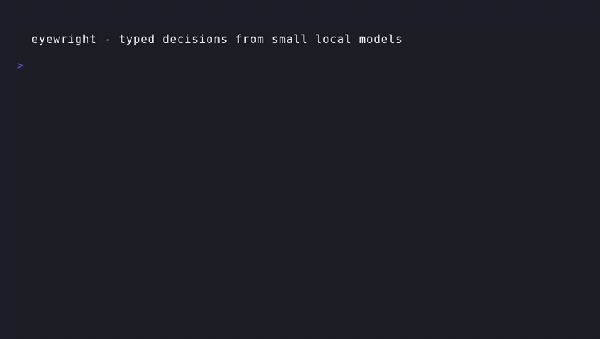

# eyewright

**eyewright** — the decision core of the local-agent stack. A committee of local
decision models behind one callable, used at the *decide* step of an agent worker
loop and available to any program or AI harness.

> **Name:** `eyewright` throughout — distribution, import, CLI, and MCP tools.

- **Third eye (main):** `laya-typed-decisions` — local specialist, 0.766 acc /
  Brier 0.019 on the typed-decisions bench.
- **Two sensory eyes (consults):** `tev1:4b` + `laya-multilingual`. In the
  0.25–0.75 uncertain band both consult; `>= 2` confident (`>= 0.9`) and
  agreeing → consensus; one confident + another within 0.05 of main →
  review-conflict → the caller gathers more evidence.

## Demo

Four calls, one per decision kind — **accept → send back → refuse → escalate**:

| question | verdict |
|---|---|
| `Is the task done?` (all work merged) | `consensus-accept` — primary unsure at 0.6663, both consults agree |
| `Is the task done?` (untested retry loop) | `review-low` — sure, so no consult is spent |
| `Is this migration safe?` (drops a live column) | `consensus-reject` — both consults say no |
| `Safe to merge?` (deployed, no alerts) | `review-conflict` — the consults disagree, so gather evidence |



Higher-resolution version: [`docs/demo/eyewright-demo.mp4`](docs/demo/eyewright-demo.mp4).
Both are generated from VHS tapes — see [`docs/demo/`](docs/demo/README.md).

## Install

```powershell
pip install eyewright        # or: uv add eyewright
```

```python
from eyewright import ask

ask(cfg, "a = 1, b = 2", "Which relation holds?",
    choices={"a_bigger": "a is bigger", "b_bigger": "b is bigger"})
```

`cfg` is a gate config (see `examples/gate.json`). The default gate is fully
local; a cloud eye is opt-in. Four ways to call it — **Python · CLI · HTTP ·
MCP** — are below.

## Local-first, with an optional upgrade

The default gate is **fully local** — Ollama (`gemma4:12b`, `tev1:4b`) plus a local
Laya checkpoint. No prompts leave the machine; the numbers below come from the
**frozen holdout** (600 rows held out of the 1,800-row train split; calibration fit
on the other 1,200 — see `bench/HOLDOUT-2026-10-09.md`, `bench/RIGOR.md`).

Individual eyes can optionally be upgraded to a **cloud model with ZDR routing**:
`typesafe/jev-1.13` (Typesafe's System One decision model) is reachable through
OpenRouter's native decisions API and plugs in as a drop-in consult
(`"type": "openrouter-decisions"`, `"zdr": true`, key from `OPENROUTER_API_KEY`) —
see `examples/gate-jev.json`.

Frozen-holdout gate table (main = `laya-typed-decisions`; screening, not confirmatory):

| gate | acted % | acted accuracy | network |
|---|---|---|---|
| local default trio: `tev1:4b + laya-multilingual` | 17.2% | 84.5% | none |
| local System-2 add: `+ gemma4:12b` | 30.8% | 83.2% | none |
| calibrated System-2 add: `+ gemma-cal` | 19.0% | 86.8% | none |
| triple: `+ jev-router-raw + gemma-raw` | **40.2%** | 88.0% | ZDR |
| calibrated triple: `+ jev-router-cal + gemma-cal` | 22.5% | **88.9%** | ZDR |
| cloud main: `jev-1.13` main + `tev1:4b + laya-multilingual` | 25.8% | 86.5% | ZDR |

Read: the weak link is `laya-multilingual` (its consensus calls are ~71% right on
the holdout). Adding System-2 consults roughly doubles automation at equal-or-better
acted accuracy; calibrating them raises precision further but fires less often
(honest confidence clears the 0.9 bar rarely). Test-set continuity:
`bench/SCREENING-2026-10-09-calibrated.md` (calibrated triple 30.3% @ 90.1% vs
incumbent 23.7% @ 90.8%).

ZDR here is **request-level routing** (`provider.zdr`), not a cryptographic
guarantee: it keeps prompts away from providers that retain data, but only
self-hosting is independently verifiable. That trade — more automation at the cost
of "nothing leaves the box" — is the point of making it a switch.

```powershell
$env:OPENROUTER_API_KEY = "<key>"
uv run eyewright gate --config examples/gate-jev.json --state "..." --question "Is the task complete?"
```

## Four ways to call it

**Python**
```python
from eyewright import ask

result = ask(cfg, "a = 1, b = 2", "Which relation holds?",
             choices={"a_bigger": "a is bigger", "b_bigger": "b is bigger"})
# -> {"kind": "choice", "answer": "b_bigger", "confidence": 0.0038, ...}
```

**CLI**
```powershell
uv run eyewright ask  --state "The sky is blue." --question "Is the statement true?"
uv run eyewright ask  --state "a = 1, b = 2" --question "Which relation holds?" --choices '{"a_bigger":"a is bigger","b_bigger":"b is bigger"}'
uv run eyewright gate --state "..." --question "Is the task complete?"
```

**HTTP** (for any language)
```powershell
uv run eyewright serve --port 8090
# GET  /health
# POST /v1/gate  {"state": "...", "question": "..."}                  -> {p_done, decision, trace}
# POST /v1/ask   {"state": "...", "question": "...", "choices"?|"levels"?, "engine"?: "generative"|"auto"}  -> {kind, answer, confidence, ...}
```

Auth & TLS: `serve` is loopback-only by default. Binding off-loopback
(`--host 0.0.0.0`) **requires** a bearer token, and requests must send
`Authorization: Bearer <token>`. Set it via **`$EYEWRIGHT_TOKEN`** — a token
passed as `--token` is visible to any local user in the process list (`ps`,
`Win32_Process`), so the CLI warns when you use it. Add `--cert`/`--key` to
serve HTTPS. The token is authentication, not encryption - off-loopback use TLS
(or an SSH/VPN tunnel). Request bodies are capped (default 1 MB).

**MCP** (for any AI harness)
```powershell
uv run eyewright mcp
# tools: eyewright_gate(state, question), eyewright_ask(state, question, choices?, levels?, engine?)
```
Smoke test: `uv run python tests/mcp_smoke.py`.

Example harness wiring. Use the **venv exe directly** so a harness reload never
triggers a `uv sync`/lock cycle:

```jsonc
"eyewright": {
  "type": "local",
  "command": ["C:/Users/<you>/projects/eyewright/.venv/Scripts/eyewright.exe", "mcp",
              "--config", "C:/Users/<you>/projects/eyewright/examples/gate.json"],
  "cwd": "C:/Users/<you>/projects/eyewright"
}
```

Setup: `uv sync` once. The `runtime` group in `pyproject.toml` holds `mcp` +
`pystray` + `pillow`, and it is a **default** group — so every later `uv sync`
(exact, so it prunes extras) and `uv run` keeps those packages installed. A
published install opts in instead: `pip install 'eyewright[mcp]'`.

Config for all four faces: `examples/gate.json` (primary + consults +
thresholds). Pass `--config <path>` elsewhere.

## Engines behind `ask`

| engine | what runs | notes |
|---|---|---|
| `typed` (default) | yes/no: the three-eye committee; choose/rate: the primary decision model | specialist domain; committee trace |
| `generative` | a local LLM (`gemma4:12b` via the config's `generative` block) with a strict JSON contract | returns answer + reason; confidence is the model's own estimate — **not calibrated yet** (`"calibrated": false`) |
| `auto` | typed first; generative fallback when the typed path errors or has no signal | needs a `generative` block |

```powershell
uv run eyewright ask --engine generative --state "a = 1, b = 2" --question "Is b greater than a?"
# -> {"kind": "noul", "answer": "yes", "confidence": 1.0, "reason": "...", "calibrated": false}
uv run eyewright ask --engine auto --state "..." --question "..."
```

Where a deterministic check exists (`a > b`), call the check — eyewright is for
judgment, not arithmetic.

Gate confidence on any von map must read the pre-band posterior (`noul_raw`);
von is retired from the consult roster (2026-10-06). See `docs/THREE-EYE.md`.

## Layout

- `eyewright/gate.py` — three-eye policy (`decide_gate`) + systemone clients.
- `eyewright/decide.py` — `ask()`: one call, any typed decision.
- `eyewright/server.py` — `eyewright serve` HTTP service.
- `eyewright/mcp_server.py` — `eyewright mcp` stdio MCP tools.
- `eyewright/cli.py` — `eyewright gate|ask|serve|mcp`.
- `bench/` — validation bench + saved responses; `docs/` — THREE-EYE,
  GATE-ANALYSIS, RESULTS, ENSEMBLE.

## Services it talks to

| service | address | notes |
|---|---|---|
| laya-serve | `127.0.0.1:8000` | key file at `~/.config/eyewright/laya-api-key`. **Default checkpoint is `english`** — always pass `"model":"typed-decisions"` for the specialist (or `"multilingual"`); the router only auto-routes when `LAYA_AUTO_TASK=1` |
| Ollama | `127.0.0.1:11434` | `tev1:4b` via `/v1/systemone` |
| von | `127.0.0.1:8001` | `von-sdk`; retired as a consult |

> **Gotcha (2026-10-09):** `laya-serve`'s default checkpoint is `english`. A gate
> entry that omits `"model"` silently uses the wrong main eye (measured on the noul
> proxy: 0.44 vs 0.86 accuracy). Always pin `"model": "typed-decisions"`.

## Resilience

- **Tray** (`eyewright[tray]`): one windowless process that owns the supervisor,
  shows an eye in the notification area, and opens a *Decide* window — drop a
  file or type a question, get the same gate. The icon is the health signal
  (green = `eyewright - ready`, amber = a service down) and follows the taskbar
  theme.

  ```powershell
  pip install 'eyewright[tray]'
  eyewright-tray          # tray + supervisor + Decide
  ```

  State lives outside the install: `%LOCALAPPDATA%\eyewright` (`$EYEWRIGHT_HOME`
  to override) holds the pid, logs, and default configs. Autostart at logon in a
  source checkout: `pwsh -File supervisor/install.ps1 -Tray`.
- **Supervisor** (`eyewright-svcwatch`): keeps local services alive — health
  probe, detached restart with backoff, logs, single instance. The descriptor is
  `$EYEWRIGHT_SERVICES`, else `<state>/services.json`, else
  `supervisor/services.json` in a checkout; `laya-serve`'s entry pins
  `LAYA_DEFAULT_MODEL=typed-decisions`. The contract is generic — any service
  runner can adopt it.
- **Caller**: `decide_gate` retries the primary (`attempts`, `retry_backoff_s`;
  `retries` is a legacy alias for attempts-beyond-first) and applies
  `on_primary_unavailable`: `fallback` (default) / `review` / `error`. Per-eye
  requests time out at `timeout_s` (default 120). The trace always records
  `policy` and `primary_error`, so degradation is never silent.
  `eyewright gate --start-services` runs the supervisor once first.
- **Deep health**: `GET /health/deep` (or `/health?deep=1`) reports per-dependency
  reachability (laya-serve, ollama, openrouter).

## Egress & privacy

The default gate is **fully local** — no prompts leave the machine. Configuring
an `openrouter-decisions` eye sends `state`/`question` to OpenRouter; `"zdr": true`
is **request-level routing**, not a guarantee (only self-hosting is independently
verifiable). Treat `state` as leaving the box whenever a cloud eye is configured.

## Security

Gate configs are **trusted input** — they can name a `key_file` (read from disk)
and a `url` (where the key is sent); only run configs you trust. Serving is
loopback-only by default; see "Auth & TLS" above. Report vulnerabilities per
[`SECURITY.md`](SECURITY.md).

## Roadmap

1. ✅ `eyewright ask` (package + CLI) and `eyewright serve` (HTTP).
2. ✅ `eyewright mcp` (stdio MCP: `eyewright_gate`, `eyewright_ask`) — usable from
   any MCP-capable harness (OpenCode, Cursor, Claude Desktop, ...).
3. ✅ Generative engine behind `ask` (`--engine generative` / `auto`).
4. Next: post-hoc calibration of the generative engine; wire it as an advisory
   verifier provider into an agent control plane (never the source of truth).

## License

Apache-2.0 — see [`LICENSE`](LICENSE) and [`NOTICE`](NOTICE). Contributions are
accepted under the Developer Certificate of Origin ([`DCO`](DCO)); see
[`CONTRIBUTING.md`](CONTRIBUTING.md).